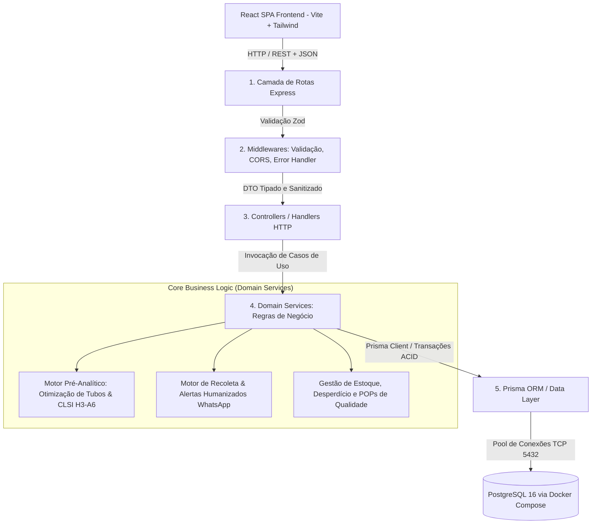

# NotusLab LIMS — Especificação Arquitetural e Modelagem de Engenharia de Software

**Documento:** Plano Arquitetural, Estrutura de Diretórios, Modelagem de Dados e Decisões de Engenharia  
**Projeto:** NotusLab LIMS (Laboratory Information Management System B2B)  
**Instituição:** Laboratório de Programação — Prof. Willen Leolatto Carneiro  
**Stack Principal:** Node.js (v22+), Express.js, Nodemon, Prisma ORM, PostgreSQL 16 (Docker Compose), React (Vite + TypeScript + Tailwind CSS)  
**Versão:** 1.0.0 (Conformidade Acadêmica Total)  

---

## 1. Visão Geral e Princípios Arquiteturais

Para atender à criticidade operacional, rastreabilidade regulatória (**RDC 786/2023 da ANVISA**) e garantia de integridade analítica, o backend do **NotusLab LIMS** adota uma **Arquitetura em Camadas com Separação de Preocupações (Separation of Concerns - SoC)** fundamentada em princípios de **Clean Architecture** e **Domain-Driven Design (DDD) pragmático**.

### 1.1 Diagrama Geral de Arquitetura e Fluxo de Requisição

---

## 2. Responsabilidades por Camada

### 2.1 Camada de Apresentação e Rotas (`src/routes/`)
- Declaração semântica dos endpoints RESTful sob o prefixo `/api/v1/...`.
- Encaminhamento da requisição após a aplicação dos esquemas de validação do Zod.
- Separação modular de rotas (`quality.routes.ts`, `index.ts`).

### 2.2 Camada de Validação e Middlewares (`src/middlewares/`)
- **`validate.middleware.ts` / Validação Zod:** Interceptação antecipada (`Fail-Fast`) de parâmetros de rota, query strings e payloads de body, garantindo tipos estritos antes de alcançar os serviços de domínio.
- **`errorHandler.ts`:** Captura centralizada de exceções (`AppError`, `ZodError` e falhas inesperadas 500), garantindo contratos de erro padronizados e impedindo vazamento de dados internos de infraestrutura.

### 2.3 Camada de Serviços de Domínio (`src/services/`)
O núcleo das regras de negócio do laboratório clínico:
1. **`PreAnalyticalEngineService`**:
   - Agrupa múltiplos exames compatíveis no mesmo tubo de coleta físico com base no aditivo/anticoagulante e matriz biológica.
   - Aplica a padronização internacional **CLSI H3-A6** para a sequência de coleta (Citrato Azul -> Soro Amarelo/Vermelho -> Heparina Verde -> EDTA Roxo -> Fluoreto Cinza).
   - Calcula o jejum máximo exigido e unifica orientações preparatórias ao paciente.
2. **`SampleRecollectionService`**:
   - Trata a recusa técnica de amostras (hemólise, coagulação, volume insuficiente, lipemia).
   - Invalida a amostra atual e cria atomicamente a amostra de recoleta com rastreabilidade total (`isRecoleta = true`).
   - Gera template humanizado de comunicação via WhatsApp com os dados do protocolo e orientações para o paciente.
3. **`FinancialQualityService`**:
   - Consolida perdas financeiras operacionais decorrentes de recoletas e descartes de materiais por período.
   - Monitora estoques críticos de reagentes laboratoriais (nível atual vs. nível mínimo de segurança).
   - Registra Procedimentos Operacionais Padrão (POPs) e ações corretivas em conformidade com as normas sanitárias.

### 2.4 Camada de Acesso a Dados (`prisma/`)
- Modelagem declarativa via Prisma Schema tipado ponta a ponta.
- Transações ACID (`prisma.$transaction`) em operações compostas (ex: recusa de amostra + criação de recoleta + registro de ocorrência).
- Migrations versionadas e rastreáveis no banco relacional PostgreSQL 16.

---

## 3. Infraestrutura e Banco de Dados (Docker Compose)

O banco de dados relacional é provisionado via Docker Compose, atendendo às regras da disciplina:
- **Engine:** PostgreSQL 16 (`postgres:16-alpine`).
- **Persistência:** Volume nomeado `notuslab_postgres_data`.
- **Isolamento de Rede:** Bridge network dedicada `notuslab_network`.
- **Healthcheck:** Verificação ativa de disponibilidade via `pg_isready` a cada 5 segundos.

---

## 4. Frontend SPA (React + TypeScript + Tailwind CSS)

O frontend foi concebido como uma Single Page Application reativa:
- **Tecnologias:** React 18, Vite, TypeScript, Tailwind CSS, Lucide Icons, Axios.
- **Páginas Principais:**
  - `RecepcaoPage`: Entrada de atendimentos, seleção de exames e acionamento do motor pré-analítico.
  - `ColetaPage`: Fila de flebotomia com visualização dos tubos ordenados por CLSI e registro de recusa/recoleta.
  - `CatalogoExamesPage`: Consulta de mnemônicos, preparos, materiais e preços.
  - `GestaoQualidadePage`: Dashboard de custos de desperdício, estoque de reagentes e POPs.
  - `LaudoPage`: Digitação e liberação de laudos clínicos.
